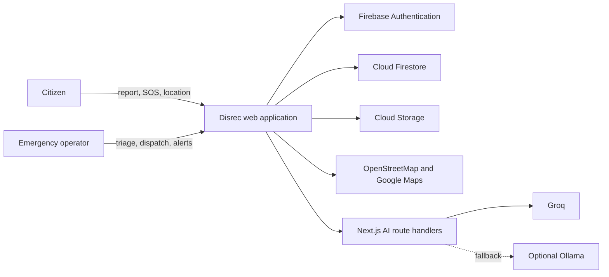
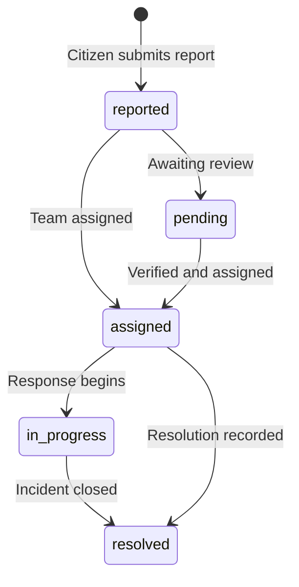

# Disrec

Disrec is an AI-assisted emergency response and disaster-management platform. Citizens can report emergencies, request SOS support, receive alerts, find safe shelters, and monitor local risks. Emergency operators use a command center for triage, dispatch, public alerts, and operational insight.

> AI output is advisory only. Critical decisions must be verified by authorized emergency personnel.

## Features

### Citizens

- Report emergencies with location, category, evidence, and severity details
- Trigger and track SOS requests
- View live incidents, nearby alerts, notifications, and safety guidance
- Use the AI emergency assistant and voice-assisted reporting
- Track linked family safety profiles
- Find an open, safe shelter and open walking directions in Google Maps

### Emergency operators

- Review, verify, assign, and update incidents
- Monitor SOS requests and response activity
- Publish emergency broadcasts and alerts
- Manage response teams, availability, and dispatch assignments
- Create shelter points with location, occupancy, capacity, amenities, and status
- Use heatmaps, analytics, AI summaries, recommendations, and incident chat
- Manage users, administrators, notifications, and settings

## Technology

| Area | Tools |
| --- | --- |
| Framework | Next.js 16, React 19, TypeScript |
| UI | Tailwind CSS, Lucide, Framer Motion, Sonner |
| Data and auth | Firebase Authentication, Firestore, Storage |
| Maps | Leaflet, React Leaflet, OpenStreetMap |
| AI | Groq API with optional Ollama chat fallback |
| Analytics | Recharts |

## Project structure

```text
app/
  (auth)/             Authentication routes
  (public)/           Citizen-facing routes
  admin/              Protected command center
  api/ai/             Server-side AI endpoints
components/           Shared UI, maps, auth, reporting, and layouts
lib/                  Firebase, data access, AI, shelter, and domain modules
firestore.rules       Firestore authorization rules
storage.rules         Storage authorization rules
```

## System overview



The web application is split into two primary experiences:

| Experience | Primary users | Responsibility |
| --- | --- | --- |
| Citizen portal | Residents and affected people | Report emergencies, request SOS support, receive situational awareness, and reach a suitable shelter. |
| Admin command center | Authorized coordinators | Validate information, manage incidents and resources, publish public guidance, and coordinate response operations. |

## Functional requirements traceability

| Requirement | Implementation area | Verifiable outcome |
| --- | --- | --- |
| Submit an emergency report | `/report`, Firestore incidents | A report is saved with location, category, severity, and reporter context. |
| Request emergency assistance | `/sos`, Firestore SOS requests | A user can create and follow an SOS request through its operational status. |
| Maintain incident operations | `/admin/incidents`, `/admin/sos`, `/admin/teams` | An operator can review, update, assign, and resolve response work. |
| Publish public warnings | `/admin/alerts`, `/nearby-alerts` | A published alert appears in citizen-facing alert views. |
| Manage shelters | `/admin/shelters`, Firestore shelters | An admin can create, edit, capacity-update, close, or remove a shelter point. |
| Guide evacuation | `/evacuation`, `lib/shelters.ts` | A person receives an available shelter recommendation and can open walking directions. |
| Provide AI assistance | `/api/ai/*` | AI responses are generated only through server-side handlers and are labelled as advisory. |

## Core data model

| Collection | Key fields | Writer | Reader |
| --- | --- | --- | --- |
| `users` | role, profile, contacts, notification preferences | User or admin | Authenticated users/admins |
| `incidents` | category, severity, coordinates, status, assignment | Citizen or admin | Authenticated users |
| `incident_updates` | status change, message, visibility | Admin | Public updates or admins |
| `sos_requests` | user, coordinates, emergency type, status | Citizen/admin | Authenticated users/admins |
| `emergency_alerts` | message, severity, location radius, expiry | Admin | Authenticated users |
| `response_teams` | discipline, availability, position, assignment | Admin | Authenticated users |
| `shelters` | coordinates, capacity, occupancy, status, amenities | Admin | Authenticated users |
| `notifications` | recipient, message, type, read state | Admin/system | Intended user or admin |

The Firestore rules are the source of truth for data authorization. Application-level route checks improve navigation, but they are not a replacement for deployed database rules.

## Quick start

### Prerequisites

- Node.js 20.9+
- npm 10+
- Firebase project with Email/Password authentication enabled
- Groq API key for AI features

```bash
git clone <your-repository-url>
cd my-app
npm install
npm run dev
```

Visit [http://localhost:3000](http://localhost:3000).

## Environment variables

Create `.env.local`. Never commit it or any service-account credentials.

```bash
# Firebase web app configuration
NEXT_PUBLIC_FIREBASE_API_KEY=
NEXT_PUBLIC_FIREBASE_AUTH_DOMAIN=
NEXT_PUBLIC_FIREBASE_PROJECT_ID=
NEXT_PUBLIC_FIREBASE_STORAGE_BUCKET=
NEXT_PUBLIC_FIREBASE_MESSAGING_SENDER_ID=
NEXT_PUBLIC_FIREBASE_APP_ID=
NEXT_PUBLIC_FIREBASE_MEASUREMENT_ID=

# AI provider
GROQ_API_KEY=
GROQ_MODEL=llama-3.3-70b-versatile

# Optional local fallback for chat
OLLAMA_BASE_URL=http://localhost:11434
OLLAMA_MODEL=gemma2:2b
OLLAMA_TIMEOUT_MS=120000
```

## Firebase setup

1. Create a Firebase project and register a web app.
2. Enable **Authentication > Email/Password**.
3. Create a Cloud Firestore database and configure Storage if users upload evidence.
4. Add the Firebase web configuration to `.env.local`.
5. Review and deploy the repository rules:

```bash
firebase deploy --only firestore:rules,storage
```

Firestore stores users, incidents, incident updates, SOS requests, notifications, emergency alerts, response teams, shelters, and administrator audit logs. Local seed data provides an offline/demo fallback for selected workflows.

## Roles

| Role | Access |
| --- | --- |
| `user` | Citizen workflows, alerts, maps, profile, and evacuation guidance |
| `admin` | Full command center |
| `super_admin` | Command center and administrator management |
| `incident_manager` | Incident response operations |
| `monitoring_admin` | Monitoring workflows |
| `alert_manager` | Alert workflows |

## Shelter and evacuation flow

1. An admin publishes a shelter location, capacity, occupancy, operational status, amenities, and contact details in **Admin > Shelter Points**.
2. Firestore syncs the shelter directory to authenticated citizens.
3. The citizen opens **Shelters**, shares their location, and receives recommendations based on distance, spare capacity, and active-incident caution zones.
4. Google Maps provides walking directions to the selected shelter.

### Recommendation policy

Only shelters that are **open** and have spare capacity are eligible. The recommendation algorithm prioritizes the safest available option by considering:

- Distance from the user’s selected or device location
- Remaining shelter capacity
- Separation from active incident caution zones, weighted by incident severity

The in-app map is an operational visual aid. Turn-by-turn directions are delegated to Google Maps, and official emergency instructions always take precedence.

## AI endpoints

| Endpoint | Purpose |
| --- | --- |
| `POST /api/ai/classify` | Suggest incident severity |
| `POST /api/ai/quick-report` | Extract a structured emergency report from a conversation |
| `POST /api/ai/summarize` | Summarize an incident for operators |
| `POST /api/ai/recommend` | Generate operational recommendations |
| `POST /api/ai/analyze` | Analyze patterns, hotspots, and report quality |
| `POST /api/ai/chat` | Emergency assistant and incident-context chat |

AI calls are handled server-side, so `GROQ_API_KEY` is never exposed to the browser. Chat can use Ollama when Groq is unavailable.

## Commands

```bash
npm run dev      # Start development mode
npm run lint     # Run ESLint
npm run build    # Create a production build
npm run start    # Serve the production build
```

## Evaluation guide

Use the following checks to evaluate an end-to-end deployment.

### Baseline checks

```bash
npm install
npm run lint
npm run build
npm run start
```

Expected result: lint completes without errors, the production build completes, and the application is reachable locally.

### Role and workflow checks

| Scenario | Steps | Expected result |
| --- | --- | --- |
| Citizen incident reporting | Sign in as a citizen, submit `/report`, then open My Reports. | The report appears with its saved details and current status. |
| SOS workflow | Sign in as a citizen, trigger SOS, then inspect it as an admin. | The request is visible to operators and its status can be updated. |
| Admin access control | Sign in as a citizen and attempt `/admin/dashboard`. | The user is redirected away from the command center. |
| Alert publishing | Publish an alert as an admin and open the citizen alert feed. | The published alert is visible to eligible signed-in users. |
| Shelter lifecycle | Create an open shelter with spare capacity, then change it to full or closed. | It appears in the directory when open and is excluded from evacuation recommendations when full or closed. |
| Evacuation navigation | Open `/evacuation`, allow location access, select a recommendation. | The page displays distance/capacity/safety information and opens Google Maps walking directions. |
| AI failure handling | Temporarily omit `GROQ_API_KEY` and use chat with Ollama available. | Chat attempts the configured Ollama fallback; other AI endpoints return a controlled error when no provider is available. |

## Quality and safety boundaries

- This platform supports coordination; it is not a replacement for public emergency services, dispatch infrastructure, or official evacuation orders.
- Location sharing requires explicit browser permission and may be unavailable or inaccurate.
- Map tiles and Google Maps are third-party services; navigation availability depends on connectivity and provider service.
- AI outputs can be incomplete, incorrect, or outdated. Operators must validate every recommendation before acting on it.
- Local seed data is suitable for demonstration and resilience, not as an authoritative emergency record.
- Before production use, conduct threat modeling, privacy review, load testing, accessibility testing, and an incident-response tabletop exercise.

## Complete feature inventory

This section is intentionally route-oriented so evaluators can map product claims directly to the implementation.

### Public and citizen experience

| Route | Feature | Capabilities |
| --- | --- | --- |
| `/` | Landing page | Product overview, emergency category discovery, safety content entry points, sign-in/report/map calls to action, and authenticated live incident summary. |
| `/login` | Authentication | Firebase email/password sign-in, development mock sign-in, and demo Aadhaar/OTP pathway. |
| `/register` | Account creation | Citizen account registration and profile initialization. |
| `/forgot-password` | Account recovery | Password-reset initiation workflow. |
| `/dashboard` | Citizen dashboard | Personal incident visibility, notification summary, family safety view, location-based map context, and emergency quick actions. |
| `/report` | Emergency reporting | Structured incident submission with category, severity, location, people affected, evidence, and AI-assisted classification. |
| `/my-reports` | Personal report history | Citizen-scoped incident list and status monitoring. |
| `/my-reports/[id]` | Report detail | Individual incident information and public response updates. |
| `/sos` | SOS assistance | Urgent assistance request with geolocation, description, and response-state tracking. |
| `/live-map` | Live situational awareness | Map-based display of incidents and operational context. |
| `/nearby-alerts` | Public alert feed | Published emergency alerts and warning details. |
| `/notifications` | Notification center | User-targeted and broadcast notification viewing and read-state management. |
| `/profile` | Profile and family safety | User information, notification preferences, emergency contacts, and linked family information. |
| `/assistant` | AI emergency assistant | Multilingual emergency guidance and incident-aware chat. |
| `/safety` | Preparedness content | Safety guidance for fire, flood, medical, and earthquake situations. |
| `/evacuation` | Shelter navigation | Browser location lookup, safe-shelter recommendations, capacity information, incident caution zones, and Google Maps walking navigation. |

### Admin command center

| Route | Feature | Capabilities |
| --- | --- | --- |
| `/admin/dashboard` | Command dashboard | Operational summary, high-priority activity, incident and response visibility, and command shortcuts. |
| `/admin/incidents` | Incident management | Search, filter, review, verify, prioritize, assign, update, and resolve incident reports. |
| `/admin/incidents/[id]` | Incident workspace | Full incident detail, timeline, assignment context, AI summary/chat support, and response coordination. |
| `/admin/sos` | SOS management | Monitor active SOS signals, acknowledge, progress, resolve, and record operator notes. |
| `/admin/teams` | Response-team management | Create, edit, filter, seed, decommission, and change readiness of fire, medical, rescue, police, HazMat, and civil-defense teams. |
| `/admin/alerts` | Alert management | Create, publish, inspect, and expire public emergency broadcasts. |
| `/admin/shelters` | Shelter-point management | Create, edit, publish, close, capacity-update, and remove evacuation shelters. |
| `/admin/heatmap` | Geographic intelligence | Incident-density and operational heatmap view. |
| `/admin/ai-intelligence` | AI intelligence center | AI-supported pattern, hotspot, report-quality, and operational recommendation workflows. |
| `/admin/analytics` | Analytics dashboard | Operational statistics and incident trend visualizations. |
| `/admin/users` | User management | User directory and administrative user operations. |
| `/admin/administrators` | Administrator management | Administrative account and role management. |
| `/admin/notifications` | Notification operations | Create and oversee notification delivery. |
| `/admin/settings` | System settings | Administrative configuration interface. |

### Shared platform capabilities

- Responsive public navigation, mobile administration sidebar, loading states, modals, empty states, badges, toast notifications, and a splash experience.
- Firebase-backed authentication context with role detection and a development-only mock session path.
- Firestore real-time subscriptions for incidents, alerts, response teams, and shelters.
- Local resilience fallback for selected incident, response-team, and shelter workflows when a cloud operation is unavailable.
- Geolocation support through the browser Geolocation API.
- Leaflet map layers, markers, incident caution circles, response routing, and evacuation-route visualization.
- Evidence-storage-ready Firebase integration.
- Audit-log collection support for administrative actions.
- Shared TypeScript domain contracts for users, incidents, updates, SOS requests, notifications, alerts, response teams, and shelters.

## Incident lifecycle



An incident can be classified by AI during reporting, but the submitted and operational severity remain subject to operator review. Administrators can record public or internal timeline updates as the incident moves through its lifecycle.

## Response-team disciplines

| Discipline | Intended use |
| --- | --- |
| Fire and rescue | Fire suppression, extraction, and fire-ground safety |
| Medical | Emergency medical support and triage |
| Search and disaster rescue | Search, rescue, collapse, and disaster operations |
| Police | Perimeter, traffic, crowd, and public safety support |
| HazMat | Hazardous materials and contamination response |
| Civil defense | Logistics, shelter support, and general response |

## Supported emergency categories

`fire`, `road_accident`, `medical`, `flood`, `building_collapse`, `natural_disaster`, and `other`.

Each incident can be rated `low`, `medium`, `high`, or `critical`, and can progress through `reported`, `pending`, `assigned`, `in_progress`, and `resolved` states.

## Demo accounts for evaluation

The repository includes a browser-local mock authentication path for product evaluation. It is intended only for local demonstrations and must be disabled or removed for production.

| Persona | Username | Password | Expected entry point |
| --- | --- | --- | --- |
| Citizen | `user` | `user` | `/dashboard` |
| Super administrator | `admin` | `admin` | `/admin/dashboard` |

A demonstration Aadhaar flow is also present: Aadhaar number `123321456654` with OTP `123456`. These are synthetic credentials only; do not use them as an identity-verification mechanism.

## AI behavior and guardrails

| Capability | Input | Output | Important constraint |
| --- | --- | --- | --- |
| Severity classification | Report title, category, description, affected people | Severity, confidence, rationale | Output is a suggestion, not an automatic dispatch decision. |
| Voice quick report | Conversation, selected language, optional GPS context | Structured report extraction and follow-up prompt | The user must review the extracted report before submission. |
| Incident summary | Incident record | Operator summary, concerns, actions, gaps | AI summary must be verified against the original report. |
| Operational recommendation | Active incidents and SOS requests | Priority actions and watch items | Recommendations require human coordination approval. |
| Pattern analysis | Incident dataset and analysis type | Trends, hotspots, or quality analysis | Results are only as reliable as the provided dataset. |
| Emergency chat | Conversation and optional incident context | Multilingual assistance | Not a substitute for emergency dispatch or medical advice. |

## Deployment notes

1. Set production environment variables in the host platform; never copy `.env.local` into source control.
2. Configure Firebase authorized domains for the deployed hostname.
3. Apply reviewed Firestore and Storage rules before sending users to the deployment.
4. Ensure `GROQ_API_KEY` is set only in the server environment.
5. Configure HTTPS because browser geolocation normally requires a secure context outside localhost.
6. Monitor AI provider errors, Firestore permission-denied events, and map-provider availability.
7. Establish data-retention, audit, escalation, and on-call policies before operational use.

## Production checklist

- Use separate Firebase projects for development, staging, and production.
- Deploy and test Firestore and Storage rules before launch.
- Keep server-only secrets out of `NEXT_PUBLIC_*` variables.
- Add rate limiting, request validation, monitoring, and audit-retention policies.
- Treat locations, identity data, medical information, and evidence uploads as sensitive.
- Verify all AI-generated guidance and emergency decisions with qualified personnel.

## Contributing

1. Create a branch with the `codex/` prefix.
2. Keep changes focused and type-safe.
3. Run `npm run lint` and `npm run build` before opening a pull request.
4. Update this README for new capabilities, variables, or operations dependencies.

## License

No license is currently declared. Add one before distributing the project or accepting external contributions.
